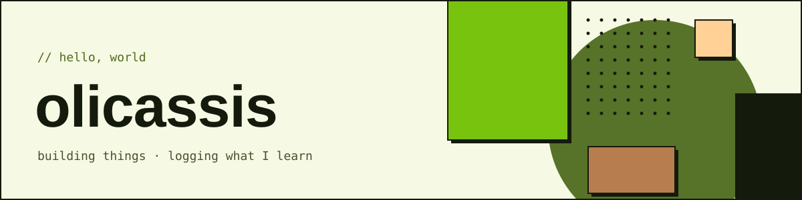
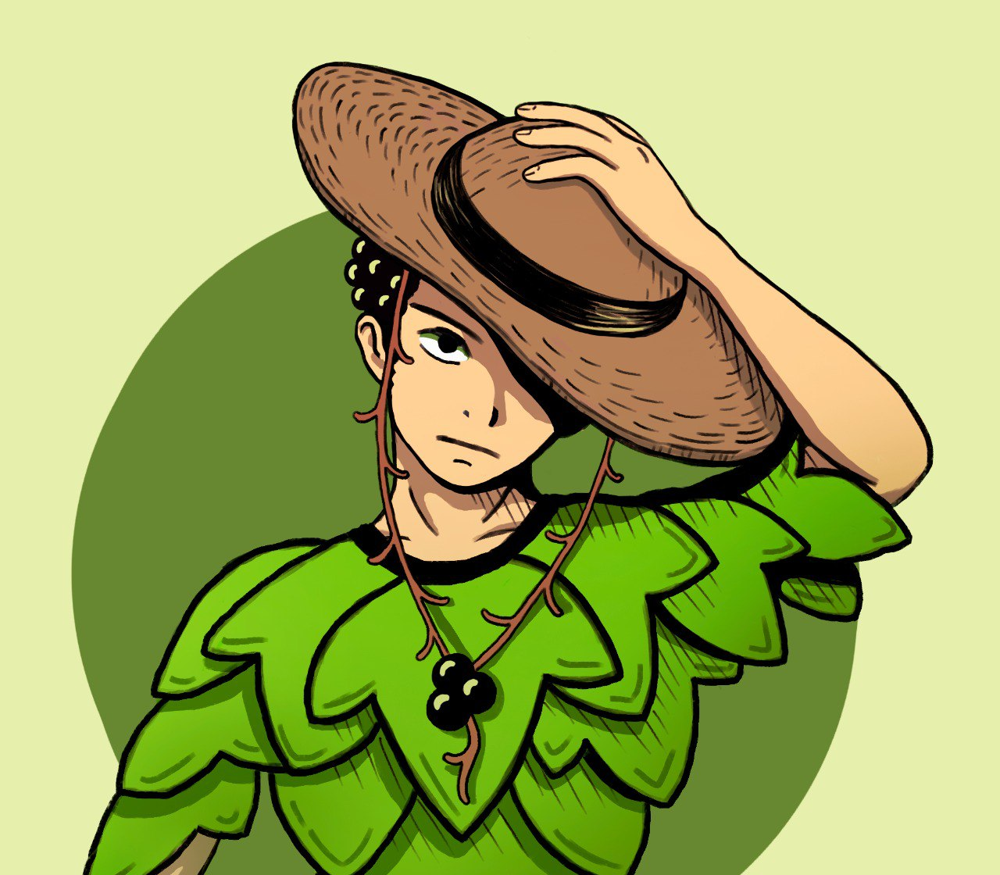

<picture>
  <source media="(prefers-color-scheme: dark)" srcset="assets/banner-dark.svg">
  
</picture>

### `// about`

**Elias Cyrino de Assis**, back-end developer at FDTE. I started in research, with speech recognition for reading assessment and search, and moved to back-end engineering.

- Now: Node.js and TypeScript systems at FDTE, with AWS serverless, event-driven services (DDD, CQRS), NestJS and Next.js, and agent harnesses for Claude Code.
- Learning: cloud and containers (AWS Certified Cloud Practitioner, 2026) and full-stack work with Claude Code.
- Before: R&D intern at Fundação CAEd. Speech recognition for large-scale reading assessment, and 6 published papers.
- Notes: software design in TypeScript, in [cs-studies](https://github.com/olicassis/cs-studies).

### `// stack`

### `// projects`

- [RecInf-TaT](https://github.com/olicassis/RecInf-TaT): a search engine for Portuguese news that flags likely fake stories.
- [Gerador de Pseudo Palavras](https://github.com/olicassis/GeradorPseudoPalavras): builds pseudo-word tests for reading fluency assessment.
- [cs-studies](https://github.com/olicassis/cs-studies): runnable notes on SOLID and design patterns.

### `// links`

 
